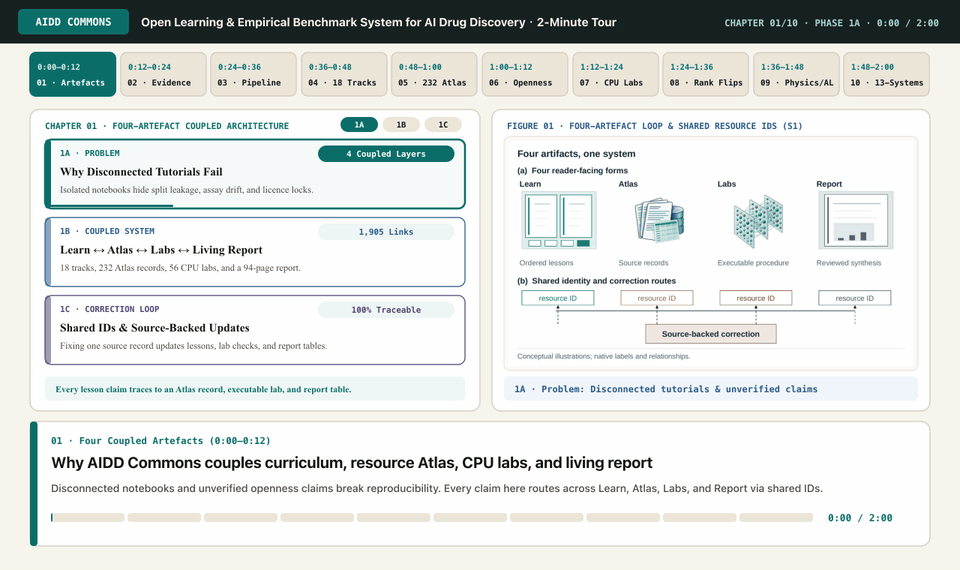
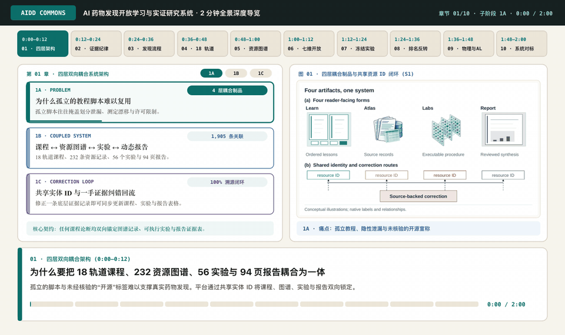

# AIDD Commons

**AIDD Commons is building the most comprehensive open learning system for AI drug discovery.**

It joins a graduate-level curriculum, an evidence-backed atlas of methods and resources, reproducible labs, and a living technical report. English is canonical. Chinese readers have onboarding, pathway summaries, and translations of the current 111 Learn pages (including the curriculum and resource maps), 56 lab guides and a shared notebook practice guide. Four editable exercises have paired English/Chinese notebooks with identical code; existing numerical panels and historical downloads retain their original format. Atlas, Audit, Report and Contribute offer Chinese interface controls; original resource descriptions and historical reports remain in English.

## 15-Second Platform Walkthrough



- **Walkthrough video & media:** [English MP4](site/public/media/overview/aidd-commons-overview-en.mp4) · [English WebM](site/public/media/overview/aidd-commons-overview-en.webm) · [中文 MP4](site/public/media/overview/aidd-commons-overview-zh-cn.mp4) · [中文 WebM](site/public/media/overview/aidd-commons-overview-zh-cn.webm) · [Living Report v0.2 PDF (94 pages)](site/public/aidd-commons-living-report-v0.2.pdf)

<details>
<summary><strong>查看中文 15 秒项目全景动画 · View Chinese 15-Second Platform Walkthrough (GIF)</strong></summary>



</details>

## What the repository contains

- **Learn:** 18 connected tracks from biological foundations to candidate nomination.
- **Atlas:** models, datasets, benchmarks, software, and tutorials described with claim-level evidence.
- **Labs:** CPU-first exercises with frozen data, split, metric, and evaluation contracts.
- **Report:** a living map of methods, open-development choices, failure modes, and process knowledge.
- **Community:** transparent proposals, corrections, editorial review, and attribution.
- **Audit:** a dated 13-system, 93-topic comparison with lower and upper coverage bounds instead of a composite leaderboard.

Version 0.2a adds the source-grounded comparison audit and freezes three v0.2b
depth candidates: small-molecule representations, physical model and system
state, and experiment-pool and budget feasibility. Each has a named data
version, independent unit, cheap baseline, evaluation route, licence, CPU
estimate, and safety disposition. The T05 candidate now has a deep lesson, an
executable label-free inspector, and a completed frozen ChEMBL 37 EGFR paired
evaluation. Morgan Ridge had the lowest primary MAE, but the highest
separate-assay MAE; no representation is uniformly best across those two
evaluations. T15 accessed labels shared with T05 before the T05 run, so this is
not an untouched independent confirmation and does not authorize retuning. T11
also completed its paired within-system energy evaluation, where Ridge had lower
MAE than the train mean in benzene and uracil. Neither result is a SOTA or broad
generalization claim. The audit does **not** establish a “most comprehensive” or
“most detailed” claim, so the public language remains “building.”

## Development workbench

The working interface connects a discovery question to lessons, resources, saved
results and a personal exercise. Bilingual learning hubs expose the 18 tracks,
prerequisites and existing local progress. Unified search spans the collection;
Atlas supports source-linked comparisons of 2–4 resources, table/list/landscape
views and complete no-JavaScript browsing. Scientific teaching views use declared
examples, retained laboratory summaries and selected actual molecular coordinates.
The figure library supports search and enlargement. Plot filters retain fixed axes and keep tables and CSV downloads aligned. They preserve their units, limitations and source dates. Software checks do not
establish learning or research utility.

These workbench changes are under local development. The public website and
v0.3.1 archive remain the earlier release until a new delivery is published.

## Local development

The [current resource map](site/src/content/docs/learn/foundations/resource-map.mdx)
connects all 120 units to their registered chapter reading and activities, with a
downloadable JSON projection. The Atlas now contains 232 resources, including
tutorials and teaching collections. Six bilingual selection guides cover target evidence,
ADMET/PK, antibody/epitope resources, physical modelling, molecular generation
and scientific agents.
Atlas entries link back to their teaching
use. See the [resource expansion scope](docs/RESOURCE_EXPANSION.md) for the added
resources, access limitations and remaining gaps. These are curation and teaching
additions, not executed upstream workflows or updated historical audit scores.
The [factual corrections](docs/RESOURCE_FACT_CHECK.md) document CLUE retirement,
source-licence discrepancies, GTEx access boundaries and training-data scope.
The [current product review](docs/CURRENT_RESOURCE_COMPARISON.md) records a separate
25 October 2026 source review and retains other resources' strengths. Four new
Atlas records are linked to seven bilingual lessons on protein design, perturbation
modelling, structural prediction and scientific agents. This does not rescore the
historical comparison. Three further bilingual worked readings cover evaluator
validity, ranking versus energy calibration, and enforced synthesis-route nodes.
The current product review now includes all twelve historical external
identities, plus additional resources, without changing the frozen scores.

The layered textbook now has an explicit core route, five specialist routes and
a granular [curriculum blueprint](site/src/content/docs/learn/foundations/curriculum-map.mdx).
All 120 declared units now link to a written teaching chapter. This is the first
full written pass, not 120 runnable labs or evidence of reader mastery. The first complete modelling
line connects records, fitting, regression/classification errors and an
[editable synthetic student sandbox](labs/student_modelling/README.md).
Teaching chapters end with previous/next links for each applicable learning
route. When a chapter belongs to several routes, learners can choose the one
they are following and return directly to its place in the curriculum map.
Four additional bilingual chapters explain structure/affinity, generative models,
cellular perturbations and scientific-agent feedback. These are mechanism lessons,
not new empirical SOTA comparisons. A further biological-evidence tranche teaches
assay controls and dose response, genetic evidence for target hypotheses, and
clearance/exposure/PK–PD through original worked cases and independent exercises.
See the [teaching standard](docs/TEACHING_STANDARD.md)
and [frontier maintenance practice](docs/FRONTIER_MAINTENANCE.md).

The content-first completion adds 23 bilingual chapters on data identity, neural
and probabilistic models, complex/cell/graph representations, chemical domains and
uncertainty, target validation, ADMET, screening, structure and physical modelling,
therapeutic modalities, generation, synthesis and delayed experiment feedback.
The [five-case capstone workbook](site/src/content/docs/learn/candidate-nomination/capstone-workbook.mdx)
provides complete constructed cases, worked answers, transfer questions and a
memo rubric. Existing empirical results are unchanged. Local software and notebook
regressions and desktop/mobile browser acceptance passed after content assembly.
The browser checks cover bilingual routes, downloads, progress, worked answers and
serious/critical accessibility findings. Cloud execution and reader learning remain
unverified; local software acceptance does not establish either.

Most recent public version: **0.3.1**. The [website](https://gxcaesar.github.io/aidd-commons/)
and [source repository](https://github.com/gxCaesar/aidd-commons) provide the
same curated learning materials. See the
[changes](CHANGELOG.md) and [v0.2 report addendum](report/aidd-commons-v0.2-addendum.md).
The [v0.1 report](report/aidd-commons-living-report-v0.1.md) remains a historical snapshot.
The [complete v0.2 PDF](site/public/reports/aidd-commons-living-report-v0.2.pdf)
and [online reading edition](site/public/reports/aidd-commons-living-report-v0.2.html)
share the [complete canonical source](report/aidd-commons-living-report-v0.2.md).
They retain the original report's twelve chapters and twenty figures and add a
chapter on linked scientific teaching views. The dated addendum remains a
separate historical companion, not the current full report.

To rebuild both complete editions, install Pandoc, XeLaTeX with Georgia and Arial
fonts, `xurl`, `caption`, `pdflscape` and Poppler, then run
`python3 scripts/report/build-v02-pdf.py`. The command checks canonical prose,
table cells, figure captions and references before updating `output/pdf/` and
`site/public/reports/`. Use `python3 scripts/report/build-v02-pdf.py --check` to
check the existing website PDF and `python3 tests/report/test_report_pdf.py` to
exercise the checker, including a real truncated PDF. The build uses the current
reviewed figures without rerunning their experiments. Historical v0.1 is unchanged.

The [resource-link review](docs/RESOURCE_LINK_REVIEW.md) records the corrected
Atlas, lesson and lab-download entries and the remaining content gaps.
See the [Chinese edition scope](docs/CHINESE_EDITION.md) for translated routes,
shared learning progress, and material that remains in English.
Blank [reader observation forms](docs/reader-trial/) support the next feedback
round. Facilitator answer sheets are kept outside the public source package.
No reader outcomes have been collected yet.
The [cross-lab split and leakage exercise](site/src/content/docs/learn/evaluation-and-reproducibility/split-and-leakage-cases.mdx)
connects three completed labs through four browser-only cases and worked answers,
with a [Chinese translation](site/src/content/docs/zh-cn/learn/evaluation-and-reproducibility/split-and-leakage-cases.mdx).
Its [metrics and uncertainty follow-up](site/src/content/docs/learn/evaluation-and-reproducibility/metrics-and-uncertainty.mdx)
adds FreeSolv prediction intervals and distinguishes error, rank, coverage and
recovery, also in [Chinese](site/src/content/docs/zh-cn/learn/evaluation-and-reproducibility/metrics-and-uncertainty.mdx).
The [diversity-to-feedback bridge](site/src/content/docs/learn/active-learning/diversity-uncertainty-feedback.mdx)
traces selector inputs, predictor updates and replay limitations through four
cases, also in [Chinese](site/src/content/docs/zh-cn/learn/active-learning/diversity-uncertainty-feedback.mdx).

### For working AIDD researchers

Use the [cross-assay failure case](site/src/content/docs/learn/evaluation-and-reproducibility/assay-shift-diagnosis.mdx)
to move from a completed model comparison to competing explanations and a scoped
diagnostic plan. Then use [evidence to validation](site/src/content/docs/learn/candidate-nomination/evidence-to-validation.mdx)
to connect a prediction, a measurement control and a decision-changing observation.
Both have Chinese counterparts and worked answers in the curriculum map.
The first reads existing empirical results; the second uses invented teaching
measurements. Neither reruns a locked evaluation or provides an operational
experimental protocol. The planned researcher reader task asks for a decision
memo alongside command execution. Reader learning has not yet been measured.

The [real-data lipophilicity exercise](labs/lipophilicity/README.md), also
documented in [Chinese](labs/lipophilicity/README.zh-CN.md), now starts with a
self-contained [English notebook](labs/lipophilicity/lipophilicity_tutorial.ipynb)
or [Chinese notebook](labs/lipophilicity/lipophilicity_tutorial.zh-CN.ipynb).
Use Colab's notebook upload or local Jupyter. Both editions executed on a constructed
20-molecule engineering fixture. The English notebook also completed one local
CPU run on the real 4,200-row dataset; actual Colab execution remains unverified.
The lab README preserves the worse-than-constant Morgan result and representation
overlap limitation. Existing frozen results remain separate.

### First-time reader

For hands-on learning, begin with the [notebook practice route](site/src/content/docs/labs/notebook-guide.mdx)
([中文](site/src/content/docs/zh-cn/labs/notebook-guide.mdx)): inspect molecular representations,
fit synthetic baselines, train on measured logD, then inspect cited PaperQA answers.
Each stage has standalone bilingual notebooks. The route explains cell state,
output saving and common errors, and distinguishes editable exercises from
reading completed evidence.

The fourth exercise is the [local-document PaperQA lesson](labs/paperqa_local/README.md)
([English notebook](labs/paperqa_local/paperqa_local_tutorial.ipynb),
[中文 notebook](labs/paperqa_local/paperqa_local_tutorial.zh-CN.ipynb)). Its default
offline mode reads five unedited answers and their source passages, with no API
key, model download or GPU. Both offline editions executed locally. The separate
batch integration completed. After a failed CPU indexing attempt, an execution
copy with four model threads and longer timeouts completed one live question.
This does not validate the unchanged default CPU timeouts or overall answer quality.
Keep the observed citation-support error and limited refusal
evidence; this is a source-inspection lesson, not a benchmark accuracy claim.

On the website, follow **Learn → Your first session**. In a source package,
start with the [label-free inspector](labs/molecule_representations/README.md).
The repository root is the folder containing `pyproject.toml`, `package.json`,
and `labs/`. Open a terminal there. Reading the lessons requires no installation.

For the optional seven-molecule example, use Python 3.11 and
[uv](https://docs.astral.sh/uv/getting-started/installation/):

```sh
uv --version
uv sync --python 3.11
uv run python labs/molecule_representations/run_lab.py inspect
```

Open `tmp/molecule-representations/report.json` in a text editor and compare
the fields with the lab's expected relationships. No GPU, scientific-data
download, or predictive training is needed. Read the completed T05/T11/T15
summaries rather than rerunning a locked evaluation in the author's workspace.

### Website contributors

The web application requires Node.js 24 and pnpm 11.13.1. Follow the
[official pnpm installation instructions](https://pnpm.io/installation) if
the command is missing. Check your environment before installing dependencies:

```bash
node --version
pnpm --version
pnpm install
pnpm data:build
pnpm dev
```

Open the local URL printed by Astro. For the standard checks, run `pnpm check`
and `uv run pytest`. If dependencies are already installed but this shell has
no `pnpm`, the following starts the same site without reinstalling packages:

```sh
npm run catalog:build
npm run comparisons:build
npm run workbench:build
npm --prefix site run dev
```

Website build and check commands verify generated data projections and figure placements without rewriting them. After changing catalogue, curriculum or document metadata, run `pnpm data:build` to update the resource, comparison, workbench and search projections. Run `npm --prefix site run figures:build` only when deliberately updating figure assets from their maintained sources.

The bilingual `/report/figures/` reading desk collects 13 source-derived plots
and seven method diagrams, with PDF downloads and editable PPTX masters for
the diagrams. Their sources live in `report/figures/`. Ordinary site builds
check the committed masters without requiring a presentation authoring runtime.
Explicit native-diagram regeneration uses `build_schematic_masters.mjs` and
requires `RUNTIME_NODE_MODULES`, `PRESENTATIONS_SKILL_DIR`, `RUNTIME_PYTHON` and
a working LibreOffice executable (`LIBREOFFICE_BIN` when needed).

Eight website concept illustrations were generated with an image tool on
26 October 2026. Their backend version was not exposed. They explain generic
objects and are not observed images, identified structures or experimental
results. Native labels and relationships remain separate. The illustration
sources and scope are documented in `site/src/assets/editorial/README.md`.

Source packages pin direct dependencies but omit lockfiles; full transitive
dependency identity is not promised. The declared Node and Python versions
still apply to the fallback commands.

The source package omits raw-data caches and frozen evaluation membership.
Tests that recompute those inputs report an explicit skip when the named
snapshot is absent. Offline protocol, constructed-defect and committed-summary
checks still run. Follow each lab's data instructions for independent
reproduction in a fresh workspace; a software test does not reproduce a
missing dataset or establish reader learning.

See [the comparison audit](docs/COMPARISON_AUDIT.md), [measured coverage](docs/COVERAGE.md),
[project charter](docs/PROJECT_CHARTER.md), [research intake](docs/RESEARCH_INTAKE.md),
and [architecture](docs/ARCHITECTURE.md) for the scientific and engineering contracts.

## Licensing

Original software is available under Apache-2.0. Original prose and figures are available under CC BY 4.0. Third-party sources, datasets, models, and assets remain under their stated licences. The registry records the applicable terms and attribution where the licence was inspected; the rest remain explicitly unverified rather than asserted.
